# 2. Evidence of Relevance

## 2.1. Research Purpose and Method

An online questionnaire was conducted using Google Forms to investigate purchasing practices, previous group purchasing experience, participation barriers, and expectations concerning a proposed residential group purchasing platform.

The questionnaire was provided in Russian, Kazakh, and English. It included multiple-choice and open-ended questions. Participants were informed about the research purpose and asked to consent to the use of their responses in a de-identified form.

The questionnaire was used following consultation with the academic supervisor. It constitutes exploratory evidence for requirements development rather than a representative assessment of the wider population.

**Data collection began:** 23 October 2026.

## 2.2. Questionnaire Results

### Question 1. Consent to Participate

This question established whether respondents voluntarily agreed to participate and permitted the use of their de-identified responses in the diploma research.

The supplied screenshot shows that all 27 respondents selected the affirmative consent option.

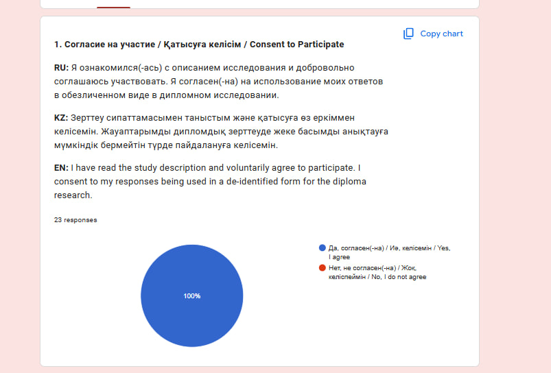

*Figure 2.1. Consent to participate: 27 responses, 100% affirmative consent.*

### Question 2. Type of Residence

This question identified respondents’ housing types and their relationship to the project’s intended residential context.

Residents of apartment buildings and residential complexes represent the primary target group. Responses from other housing types provide supplementary perspectives and should be distinguished when interpreting the results.

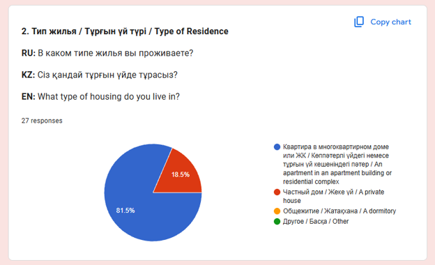

*Figure 2.2. Distribution of respondents by type of residence.*

### Question 3. Residents’ Group Chat

This question examined whether respondents had access to an existing residential communication channel and whether they participated in it.

The findings provide context for community communication. Membership in a residents’ chat does not, by itself, demonstrate that the chat is used for collective purchasing or that members would adopt the proposed platform.

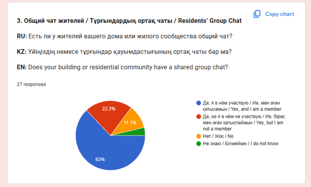

*Figure 2.3. Availability of and participation in residents’ group chats.*

### Question 4. Purchasing Essential Goods

Respondents identified where they usually purchase non-perishable food, household cleaning products, and personal hygiene items.

This question establishes the existing purchasing channels against which the proposed service should be considered. Multiple selections were permitted; therefore, percentages may exceed 100% when combined.

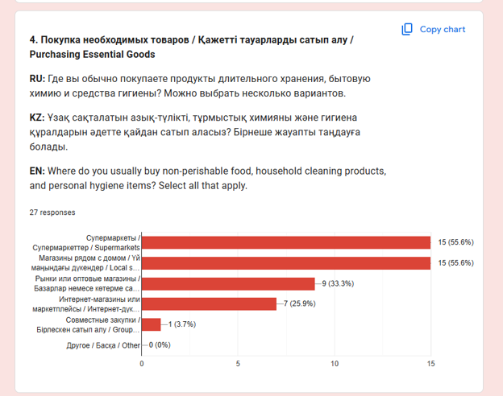

*Figure 2.4. Existing channels for purchasing essential goods.*

### Question 5. Group Purchasing Experience

This question distinguished respondents with previous participation or organising experience from those who had only considered group purchasing or had not considered it.

This distinction is important because accounts of actual purchasing experiences provide different evidence from expectations about a service that has not been used.

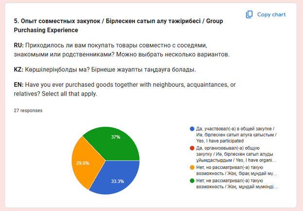

*Figure 2.5. Respondents’ previous group purchasing experience.*

### Question 6. Most Recent Experience

Respondents with relevant experience were invited to describe a previous collective purchase, including the goods purchased and the organisation of requests.

The earlier 23-response export included examples of buying fruit, sharing a case of butter among relatives, and purchasing groceries collectively. It also included a collective purchase associated with basement repairs. The repair example concerns broader community coordination and should be distinguished from purchasing essential household goods.

These examples confirm that collective purchasing occurs within some respondents’ social networks. They do not establish how frequently it occurs across the target population.

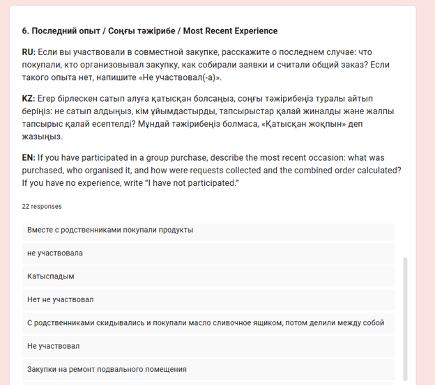

*Figure 2.6. Open-ended descriptions of previous collective purchases.*

### Question 7. Difficulties Encountered

This question examined problems encountered during previous group purchases.

The earlier export included concerns about product freshness, delivery, and collecting contributions. It also contained positive accounts in which participants reported no difficulties. The evidence therefore does not support a claim that existing arrangements are consistently problematic.

Answers from respondents without previous experience should not be presented as observed purchasing failures.

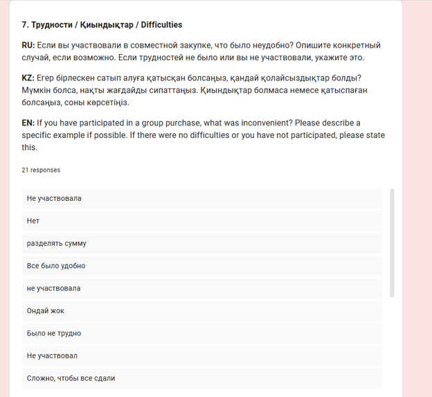

*Figure 2.7. Reported difficulties and positive experiences in group purchasing.*

### Question 8. Barriers and Conditions for Participation

Respondents described factors that could prevent participation and conditions under which they might consider joining a purchase.

The earlier export contained references to limited time, waiting, financial concerns within personal relationships, expected value, and the absence of a current need. These responses indicate that participation depends on practical circumstances and individual preferences.

The platform should communicate its conditions clearly, while recognising that some residents may prefer individual purchasing.

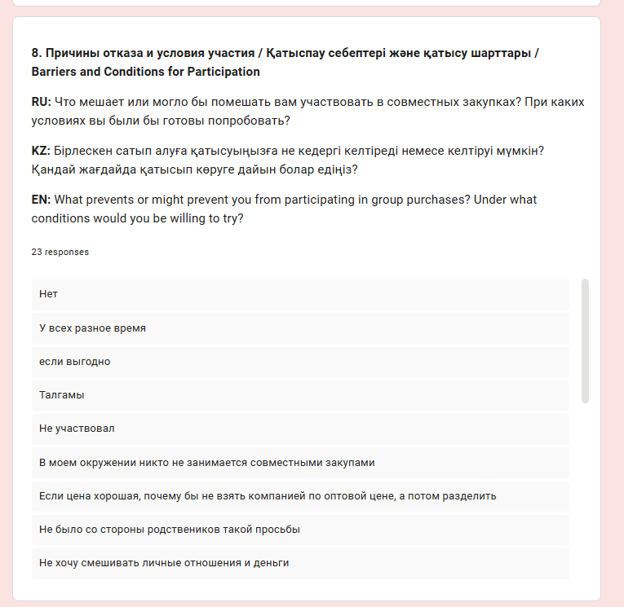

*Figure 2.8. Barriers to participation and conditions for considering group purchases.*

### Question 9. Product Categories

This question identified goods respondents would consider purchasing collectively. It also allowed respondents to indicate that they were not willing to participate.

The results will inform the initial product scope. Multiple selections were permitted, so category totals should not be treated as mutually exclusive groups. An expression of interest is not equivalent to a purchase commitment.

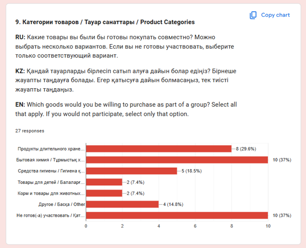

*Figure 2.9. Product categories considered suitable for collective purchasing.*

### Question 10. Information Required Before Participation

Respondents selected information they would need before joining a purchase, such as product specifications, total costs, organiser details, payment terms, and collection arrangements.

The findings inform the content of purchase details and confirmation screens. Frequently selected information should be made prominent. Less frequently selected conditions may still be necessary for operational correctness.

Multiple selections were permitted.

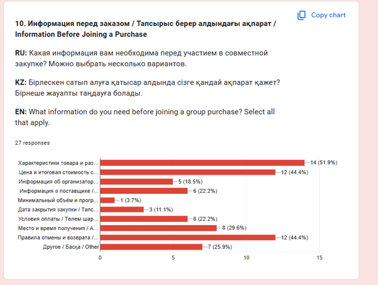

*Figure 2.10. Information required before joining a group purchase.*

### Question 11. Perceived Usefulness

After reviewing the proposed application description, respondents were invited to explain what would be useful to them.

The earlier export included expectations of convenience, time savings, and potentially favourable purchasing prices. Other respondents did not identify a personal benefit.

These statements describe perceived or expected usefulness. They do not demonstrate that the application has already reduced costs or saved time.

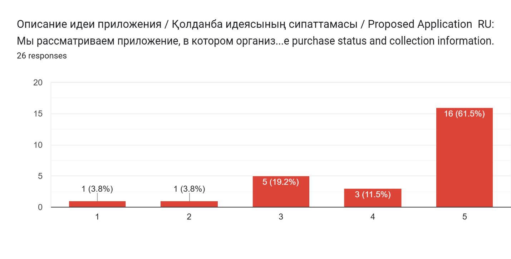

*Figure 2.11. Respondents’ views on the proposed application’s usefulness.*

### Question 12. Concerns and Reasons for Refusal

This question examined factors that could cause distrust or lead respondents to reject the proposed application.

The earlier export included concerns about fraud, product quality, delivery reliability, returns, and unclear conditions. These findings support attention to transparent purchasing information and organiser responsibilities.

Some respondents expressed no concerns. The results should therefore retain both critical and favourable perspectives.

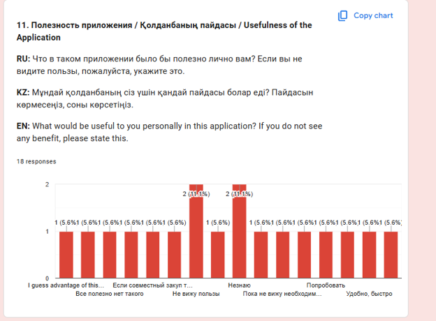

*Figure 2.12. Concerns about the proposed application and potential reasons for refusal.*

### Question 13. Additional Suggestions

The final question allowed respondents to identify issues not covered elsewhere.

The earlier export included comments concerning delivery speed, the condition of received goods, and product quality. Other respondents provided no additional suggestions or considered the proposed coverage sufficient.

Suggestions will be assessed against project objectives and implementation capacity. They will not automatically become mandatory features.

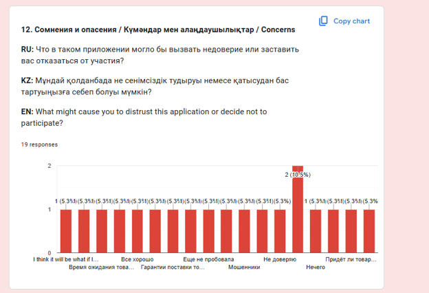

*Figure 2.13. Additional suggestions and comments.*

## 2.3. Relationship Between Findings and Requirements

The following table distinguishes observed survey content from the project team’s proposed response. Qualitative observations refer to the earlier 23-response export and should be checked against the final response set before submission.

| Survey Evidence | Interpretation | Proposed Requirement or Action |
| --- | --- | --- |
| Respondents described collective purchases with relatives or other community members | Group purchasing is a familiar practice for part of the sample | Support individual requests within a shared purchase |
| Respondents requested product and packaging information | Participants need clarity about what they will receive | Display product specifications, package sizes, and units |
| Respondents identified total costs and payment conditions as relevant | Financial conditions should be understandable before commitment | Display the calculated total and disclose additional charges |
| Responses raised cancellation, return, and quality concerns | Participants need clear procedures when conditions are not met | Display cancellation and return conditions and organiser contact arrangements |
| Responses referred to waiting and delivery reliability | Fulfilment expectations influence participation | Show expected collection information and communicate changes |
| Responses expressed distrust and concern about organisers or suppliers | Accountability should be visible | Identify the organiser and relevant supplier information |
| Some respondents reported convenient previous experiences or no need for the service | Demand varies, and existing processes may already be satisfactory | Validate usefulness through prototype testing without assuming universal demand |

Survey findings support requirements concerning information and workflow. They do not independently establish the need for a particular database, framework, or distributed processing mechanism. Those decisions require separate engineering justification.

## 2.4. Verified Findings and Remaining Assumptions

| Supported by Available Responses | Still Requires Validation |
| --- | --- |
| Some respondents have previous collective purchasing experience | Residents will use the platform regularly |
| Respondents expressed differing levels of interest | The platform will achieve sustained adoption |
| Product quality, financial conditions, trust, and timing appeared in responses | Interface features will resolve those concerns |
| Some respondents described satisfactory existing arrangements | The proposed workflow will outperform existing methods |
| Some respondents did not identify a personal need | A wider residential population will demonstrate stronger demand |

Financial savings, reduced organisational effort, and improved usability will be evaluated later under defined measurement conditions.

## 2.5. Limitations

The questionnaire provides exploratory evidence with the following limitations:

- The sample is small and cannot be assumed to represent all residential communities.
- The recruitment method and participant relationships to the team must be documented.
- Open-ended responses vary in detail, and some fields are incomplete.
- The export alone does not establish whether all submissions came from unique individuals.
- Stated interest does not demonstrate actual purchasing behaviour.
- The earlier export contains 23 responses, while the supplied consent screenshot shows 27. All final counts and figures must be reconciled to one reporting cut-off.
- A numeric field labelled as the application description has no defined scale in the export. It is excluded from interpretation unless its original question and scale labels are verified.

## 2.6. Conclusion

The questionnaire provides initial evidence of collective purchasing experience and identifies information needs, participation barriers, and concerns relevant to the proposed platform.

The findings justify further prototype development and evaluation. They support transparent product and cost information, clear purchasing conditions, and visible organiser responsibilities. They also demonstrate that interest is not universal.

The final requirements will combine these findings with technical analysis and supervisor feedback. The effectiveness of the implemented solution will be assessed separately through functional verification and user evaluation.