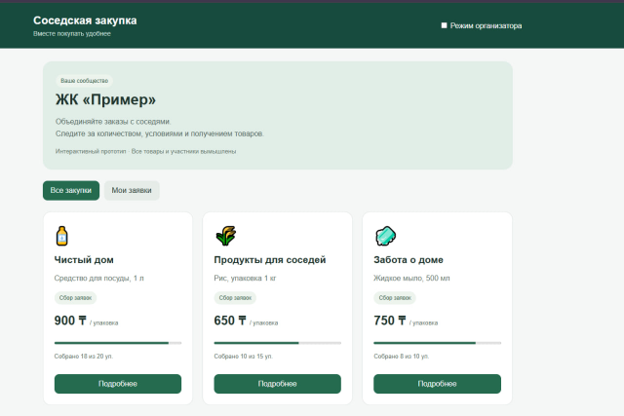

# 8. User Experience and Interactive Prototype

## 8.1. Purpose

An interactive prototype was developed to demonstrate the principal user interactions of the proposed group purchasing platform. It illustrates how residents browse purchases, submit requests, and monitor progress, and how organisers manage purchasing activities.

The prototype uses HTML, CSS, and JavaScript and runs directly in a browser. This approach allows the team to demonstrate the workflow before implementing the planned Flutter application and backend.

The prototype is a preliminary interface model. Its demonstration data and role controls do not represent a production system.

## 8.2. Main Interface

The application uses the working title “Соседская закупка” (“Neighbourhood Purchasing”). The main page displays a demonstration residential community, ЖК «Пример», followed by purchase cards.

Each card presents:

- Purchase title.
- Product name and package size.
- Price per package in Kazakhstani tenge.
- Current purchasing status.
- Aggregate quantity and minimum threshold.
- A button for viewing details.

The interface provides two tabs: **All Purchases** and **My Requests**. A demonstration switch enables organiser controls.

*Figure 8.1. Main interface of the HTML prototype showing the residential community and available group purchases.*

## 8.3. Design Approach

The interface uses a green colour scheme, contrasting action buttons, and a card-based layout. Product information, prices, and purchasing progress are grouped together to support comparison between available offers.

CSS grid and responsive layout rules allow the cards to adapt to the available screen width. Product details and management actions are presented in modal dialogs.

The initial interface is in Russian. The availability of the questionnaire in three languages does not imply that multilingual application support has already been implemented.

## 8.4. Resident Workflow

The prototype supports the following resident scenario:

1. Browse purchases within the demonstration community.
2. Open a purchase and review its conditions.
3. Select the required number of packages.
4. Review the calculated total.
5. Confirm participation.
6. View the request under **My Requests**.
7. Modify or cancel the request while collection remains open.
8. View subsequent purchasing and collection states.

The displayed conditions include organiser and supplier information, payment arrangements, collection information, and cancellation guidance.

Confirmation is requested before a participation record is saved. Changes and cancellations are blocked once the purchase leaves the request collection stage.

## 8.5. Organiser Workflow

The organiser demonstration mode provides controls for creating and progressing purchases.

| Action | Prototype Behaviour |
| --- | --- |
| **Create a purchase** | Opens a form for the purchase title, product description, unit price, and minimum quantity |
| **Publish a purchase** | Validates the form and adds the purchase to the list |
| **Close request collection** | Compares the aggregate quantity with the minimum threshold |
| **Confirm a purchase** | Moves an eligible purchase from Awaiting Confirmation to Confirmed |
| **Prepare collection** | Changes a confirmed purchase to Ready for Collection |
| **Record collection** | Marks the current demonstration user’s request as collected |
| **Cancel a purchase** | Records a reason and cancels an eligible purchase before collection |

If the minimum quantity is not reached when collection closes, the purchase is marked **Unsuccessful**. Reaching the minimum moves it to **Awaiting Confirmation**, rather than automatically confirming supplier fulfilment.

The role switch is provided for demonstration convenience. It does not implement authentication or secure authorisation.

## 8.6. Demonstration Scenario

The following example illustrates the connected workflow using the initial demonstration data:

| Step | Action | Expected Prototype Behaviour |
| --- | --- | --- |
| 1 | Open “Чистый дом” | Display dishwashing liquid, priced at 900 ₸ per package, with 18 of 20 packages collected |
| 2 | Select two packages and confirm | Save a request totalling 1,800 ₸ and increase the aggregate quantity to 20 |
| 3 | Open My Requests | Display the saved participation request |
| 4 | Enable organiser mode and close collection | Change the purchase to Awaiting Confirmation |
| 5 | Confirm the purchase | Change the status to Confirmed |
| 6 | Mark goods as ready | Change the status to Ready for Collection |
| 7 | Record collection | Display the demonstration user’s request as collected |

This scenario describes expected behaviour based on the prototype implementation. It is not a record of completed usability testing.

## 8.7. Relationship to Survey Findings

The interface incorporates information needs identified in the preliminary questionnaire responses.

| Identified Need | Prototype Response |
| --- | --- |
| Clear product and packaging information | Product descriptions include package sizes |
| Transparent purchasing costs | Unit prices and individual totals are displayed before confirmation |
| Understandable payment conditions | The details dialog explains that payment takes place outside the application |
| Cancellation and return information | Purchasing conditions include cancellation guidance and instructions for contacting the organiser |
| Visible fulfilment information | Purchase status and collection information are displayed |

These features respond to expressed information needs. Their effectiveness in improving trust or usability remains subject to evaluation.

## 8.8. Technical Implementation

| Technology | Responsibility |
| --- | --- |
| **HTML** | Page structure, forms, buttons, and dialogs |
| **CSS** | Colours, spacing, cards, typography, and responsive layout |
| **JavaScript** | Request handling, quantity calculations, validation, and status changes |
| **Browser localStorage** | Retention of demonstration data between page reloads, where available |

The prototype is contained in a single `index.html` file. It can be opened directly in a browser without a backend installation.

Data is stored locally in the browser and is not synchronised between users or devices. A reset control restores the initial demonstration purchases.

## 8.9. Current Limitations

The prototype intentionally simplifies the planned system:

- One predefined residential community.
- One product per purchase.
- No registration, login, or invitation-code membership.
- Demonstration role switching instead of access control.
- Predefined quantities representing other participants.
- Manual closure instead of automatic deadline processing.
- No supplier integration, real payments, or notifications.
- Collection recording limited to the current demonstration request.
- No complete purchase completion workflow.
- No backend, shared database, or concurrent-user processing.

Accordingly, the prototype demonstrates selected interface interactions rather than fulfilment of all requirements in [Section 6 — Requirements Specification](06-requirements.md).

## 8.10. Deliverables and Further Development

The prototype deliverables comprise the HTML source file and interface screenshots. The source file will be included in the project repository with instructions for opening and resetting the demonstration.

Further development will add community membership, complete organiser workflows, and server-enforced purchasing rules. Feedback from prototype evaluation will inform the Flutter interface.

**Prototype status:** Initial interactive HTML prototype; user evaluation pending.